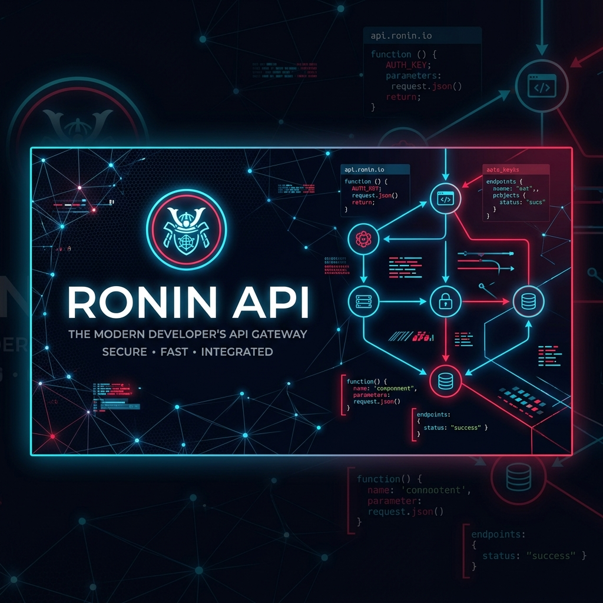

# Ronin API — Next-Gen Anime & Manga Backend

A high-performance streaming & manga API engine built for speed, resilience, and on-demand cloud mining. It serves cached stream links fast from Supabase, triggers background miners via GitHub Actions for missing episodes, resolves embed players to direct video files, and searches P2P torrent magnets.

---

## 🚀 Key Features

* **⚡ Sub-Millisecond Supabase Cache:** Instant responses for cached episode streams matching normalized title variants.
* **🤖 On-Demand GitHub Actions Miner:** Missing streams trigger background runners (`repository_dispatch`) that crawl sources and auto-save links to the database.
* **🎬 Embed-to-Direct Video Stream Resolver (`/api/resolve`):** Decrypts and resolves direct `.m3u8` master playlists and `.mp4` video files from GogoCDN, Animepahe (Kwik), and StreamSB players.
* **🧲 P2P Torrent Magnet Downloads Search (`/api/downloads`):** Scrapes Nyaa.si for quality-tagged magnets (1080p, 720p, 480p) with seeders, leechers, and file sizes.
* **🎙️ Full Sub & Dub Support:** Dedicated routing and tags for Japanese Subbed and English Dubbed audio tracks.
* **📖 MangaDex Reader Engine:** Chapter feeds and high-resolution page image array resolution.
* **☁️ Dual Deployment:** Run locally with Node.js/Fastify or deploy serverless on Vercel.

---

## 🛠️ Quickstart

### 1. Configure Environment
Create `.env` (or copy from `.env.example`):
```bash
SUPABASE_URL=https://your-project.supabase.co
SUPABASE_KEY=your-supabase-key
GITHUB_TOKEN=ghp_your_github_pat_token
GITHUB_REPO=Zcross091/Ronin-API
PORT=3000
```

### 2. Run the Server
```bash
# Install dependencies
npm install

# Start development server
npm run dev

# Or start in production
npm start
```

---

## 📑 REST API Documentation

### 1. Fast Stream Resolver & Cache
```http
GET /api/stream/:query/:episode?dub=false&forceScrape=false
```
* **Description:** Looks up cached streams from Supabase. If missing, runs instant lightweight scrapers and queues a background GitHub Actions runner.
* **Example:**
```bash
curl -X GET "http://localhost:3000/api/stream/solo-leveling/1"
```

### 2. Embed-to-Direct Video Resolver
```http
GET /api/resolve?url={embed_url}
POST /api/resolve
```
* **Description:** Decrypts GogoCDN, StreamSB, or Kwik embeds into direct `.m3u8` / `.mp4` stream links.
* **Example:**
```bash
curl -X GET "http://localhost:3000/api/resolve?url=https://embtaku.pro/encrypt-ajax.php?id=..."
```

### 3. Torrent Magnet Downloads Search
```http
GET /api/downloads?title={title}&episode={episode}&saveToDb=true
```
* **Description:** Scrapes Nyaa.si for quality-tagged torrent magnets with seeders/leechers.
* **Example:**
```bash
curl -X GET "http://localhost:3000/api/downloads?title=one+piece&episode=1100"
```

### 4. Background Miner Dispatch Trigger
```http
GET /api/trigger-miner?title={title}&episode={episode}&source={source}
POST /api/trigger-miner
```
* **Description:** Dispatches on-demand mining jobs to GitHub Actions.
* **Example:**
```bash
curl -X GET "http://localhost:3000/api/trigger-miner?title=Chainsaw%20Man&episode=1"
```

### 5. Frontend Database Proxy
```http
GET /api/db?title={title}&episode={episode}&searchVariants={json_array}
```
* **Description:** Fast lookup matching client title variants in Supabase.
* **Example:**
```bash
curl -X GET "http://localhost:3000/api/db?title=jujutsu+kaisen&episode=1"
```

---

## ⚖️ License
This project is open-source and built for educational and research studies. All video links and metadata represent search results compiled from public networks.
